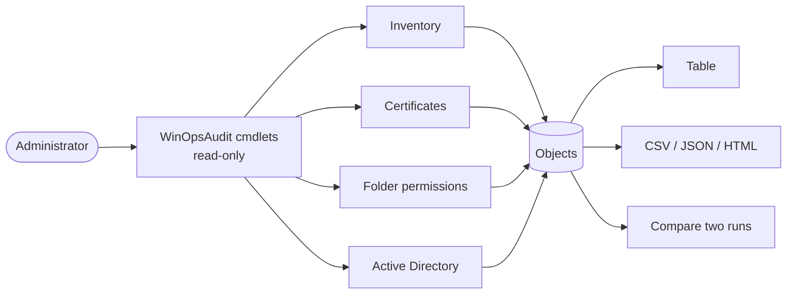
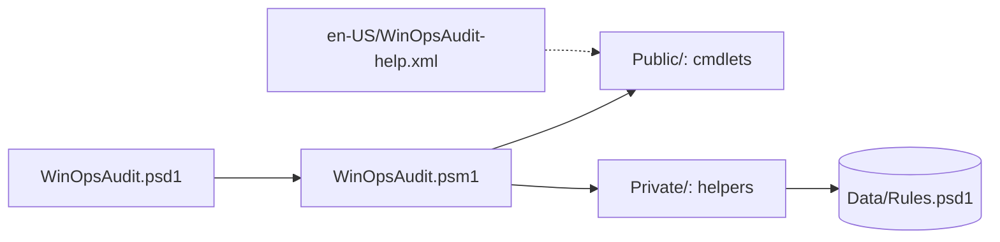

# WinOpsAudit

**Read-only audits for Windows administrators, as a PowerShell 7 module:** inventory, certificates
about to expire, folder permissions and Active Directory accounts. Every cmdlet returns objects you
can filter, export and compare, and nothing is ever changed.



[](https://github.com/zxxdev/winops-audit/actions/workflows/ci.yml)
[](LICENSE)

> **Status: early.** The module structure, the build and the rule catalog are in place; the audits
> themselves come one area at a time (see the [roadmap](#limitations-and-roadmap)). Terminal
> captures of real audits come with the first one, the inventory.

## Contents

- [Why it exists](#why-it-exists)
- [What it does](#what-it-does)
- [Quick try](#quick-try)
- [How it works](#how-it-works)
- [Technical decisions](#technical-decisions)
- [Quality](#quality)
- [Development](#development)
- [Security and privacy](#security-and-privacy)
- [Limitations and roadmap](#limitations-and-roadmap)
- [License](#license)

## Why it exists

Windows administrators end up writing the same checks again and again: which certificates expire
this month, which folders have permissions granted to people instead of groups, which accounts
nobody has used in months. Those scripts usually print text, so their output cannot be filtered,
exported or compared with last week's. WinOpsAudit does those checks as proper PowerShell cmdlets:
they return objects, have help and tests, and only read, so they are safe to run in production.

## What it does

Today: the catalog of audit rules, with `Get-WinOpsAuditRule`.

```powershell
Get-WinOpsAuditRule -Area Certificates | Format-Table Id, Severity, Status, Title
```

```text
Id      Severity Status  Title
--      -------- ------  -----
CRT-001 High     Planned Certificate expires within the warning window
CRT-002 Medium   Planned Weak signature algorithm or key size
CRT-003 Medium   Planned Server does not send its full chain
```

The catalog covers four areas. Each rule becomes `Available` when its cmdlet, its tests (a case it
must find and one it must not) and its help are written:

| Area | Rules |
| --- | --- |
| Inventory | Hardware, system and updates through CIM; installed software from the registry |
| Certificates | Expiring soon, weak algorithm, incomplete chain |
| Folder permissions | Broken inheritance, permissions on users instead of groups, unneeded full control |
| Active Directory | Unused accounts, passwords that never expire, privileged groups, unconstrained delegation |

The full help of each cmdlet is in [docs/commands](docs/commands/WinOpsAudit/WinOpsAudit.md), and
in PowerShell with `Get-Help <cmdlet> -Full`.

## Quick try

With PowerShell 7.4 or later, on Windows, Linux or macOS:

```powershell
git clone https://github.com/zxxdev/winops-audit.git
cd winops-audit
Import-Module ./src/WinOpsAudit/WinOpsAudit.psd1
Get-WinOpsAuditRule
```

The module is not on the PowerShell Gallery yet: that is the 1.0 release.

## How it works



A standard script module: the manifest says what it exports and what it needs, the cmdlets live
one per file in `Public/`, and helpers that may change freely live in `Private/`. The help is
written in Markdown and built into the file `Get-Help` reads. More in
[docs/architecture.md](docs/architecture.md).

## Technical decisions

| Decision | Why |
| --- | --- |
| [Read-only](docs/adr/0001-read-only-module.md) | Safe to run in production with read-only accounts; a person decides what to fix. |
| Objects out, formatting last | Results can be filtered, exported and compared; reports are a separate step. |
| PowerShell 7 only | Runs on Windows and Linux, so the logic is tested on both; Windows PowerShell 5.1 no longer evolves. |
| Help written in Markdown | Reviewed like any other change; [PlatyPS](https://github.com/PowerShell/platyPS) builds it into the help file. |

## Quality

Every pull request runs `./build.ps1` on **Linux and Windows**:

- **PSScriptAnalyzer** with the default rules plus formatting rules; any finding fails the build.
- **Pester** tests, with code coverage measured by Pester; the build fails below 80%.
- Tests that guard the design: the manifest exports exactly the public cmdlets, every exported
  cmdlet uses a read-only verb, and every cmdlet has a synopsis, a description, an example and a
  description for each parameter.
- **Help check:** the help file built from `docs/commands` must match the one committed.

## Development

```powershell
./build.ps1                    # Bootstrap, Lint, Test and HelpCheck
./build.ps1 -Task Lint, Test   # just some steps
```

`Bootstrap` installs the tools pinned in `build/requirements.psd1` (Pester, PSScriptAnalyzer,
PlatyPS) for the current user. See [CONTRIBUTING.md](CONTRIBUTING.md).

```text
src/WinOpsAudit/     the module: manifest, Public/, Private/, Data/, en-US/ (built help)
tests/               Pester tests
docs/commands/       the help, in Markdown (the source)
docs/adr/            decision records
build.ps1            the build, the same locally and in CI
```

## Security and privacy

- **Read-only by design**, and a test enforces it.
- **No credentials in code or output.** Cmdlets that need them will take a `PSCredential` or a name
  from [SecretManagement](https://github.com/PowerShell/SecretManagement), never a password as text.
- **Tested against a lab, not a real company.** The examples use made-up names such as
  `contoso.test`; Active Directory rules will be tested against a disposable Samba domain with
  synthetic data.

Report vulnerabilities privately: see [SECURITY.md](SECURITY.md).

## Limitations and roadmap

- No audits yet: only the rule catalog.
- Windows PowerShell 5.1 is not supported.
- The Active Directory rules read the directory over LDAP; they will not use Microsoft's
  `ActiveDirectory` module, which only exists on Windows.

| Next | What |
| --- | --- |
| Inventory | Hardware, system, updates and installed software, through CIM |
| Certificates | Local stores and remote servers: expiry, algorithm, chain |
| Folder permissions | NTFS ACL audit |
| Lab | A disposable Samba domain with planted problems, for the integration tests |
| Active Directory | Accounts, groups and delegation |
| Reports | HTML, CSV, JSON, and the difference between two runs |
| At scale | Many computers in parallel, with a limit and a timeout |
| 1.0 | Published on the PowerShell Gallery |

## License

[MIT](LICENSE).
