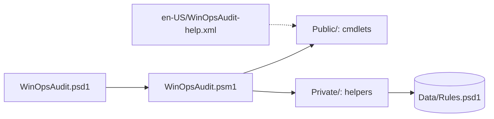

# WinOpsAudit

**Read-only audits for Windows administrators, as a PowerShell 7 module:** inventory, certificates
about to expire, folder permissions and Active Directory accounts. Every cmdlet returns objects you
can filter, export and compare, and nothing is ever changed.


[](https://github.com/zxxdev/winops-audit/actions/workflows/ci.yml)
[](LICENSE)

> **Status: early.** The first two areas, the inventory and the certificates, work; the other
> audits come one area at a time (see the [roadmap](#limitations-and-roadmap)).

## Contents

- [Why it exists](#why-it-exists)
- [What it does](#what-it-does)
- [Quick try](#quick-try)
- [How it works](#how-it-works)
- [Technical decisions](#technical-decisions)
- [Quality](#quality)
- [Development](#development)
- [Security and privacy](#security-and-privacy)
- [Limitations and roadmap](#limitations-and-roadmap)
- [License](#license)

## Why it exists

Windows administrators end up writing the same checks again and again: which certificates expire
this month, which folders have permissions granted to people instead of groups, which accounts
nobody has used in months. Those scripts usually print text, so their output cannot be filtered,
exported or compared with last week's. WinOpsAudit does those checks as proper PowerShell cmdlets:
they return objects, have help and tests, and only read, so they are meant to be run in production
with read-only accounts.

## What it does

Today: the inventory of the computer it runs on, its certificates and those of TLS servers, and
the catalog of audit rules.

| Cmdlet | Returns |
| --- | --- |
| `Get-WinOpsAuditInventory` | One object for the computer: hardware, operating system, domain, how many updates and the date of the last one |
| `Get-WinOpsAuditUpdate` | One object per installed update |
| `Get-WinOpsAuditSoftware` | One object per installed program, read from the registry (never from `Win32_Product`) |
| `Get-WinOpsAuditCertificate` | One object per certificate in the local stores: days left, algorithm, key and the rules it breaks |
| `Get-WinOpsAuditTlsCertificate` | One object per TLS server: the certificate it presents, and whether it sends the intermediates it should |
| `Get-WinOpsAuditRule` | The audit rules, available and planned |

This is real output, from the Windows Server 2025 runner of this repository's
[CI](https://github.com/zxxdev/winops-audit/actions/workflows/ci.yml) (the step "Show the inventory
of this runner"), on 2026-11-26:

```powershell
Get-WinOpsAuditInventory | Format-List ComputerName, Model, Processor, CoreCount, MemoryGB, OperatingSystem, UpdateCount, LastUpdateInstalledOn
```

```text
ComputerName          : runnervmbpeip
Model                 : Virtual Machine
Processor             : AMD EPYC 9V45 96-Core Processor
CoreCount             : 2
MemoryGB              : 16
OperatingSystem       : Microsoft Windows Server 2025 Datacenter
UpdateCount           : 3
LastUpdateInstalledOn : 11/12/2026 12:00:00 AM
```

```powershell
Get-WinOpsAuditUpdate
```

```text
HotFixId  Description     InstalledOn InstalledBy
--------  -----------     ----------- -----------
KB5127690 Update          2026-11-12
KB5131079 Security Update 2026-11-12
KB5136489 Update          2026-11-12
```

```powershell
Get-WinOpsAuditSoftware -Name '*PowerShell*', 'Git*', '*Python*'
```

```text
Name                                              Version        Publisher                     Architecture Scope
----                                              -------        ---------                     ------------ -----
Git                                               2.56.1         The Git Development Community x64          Machine
GitHub CLI                                        2.104.0        GitHub, Inc.                  x64          Machine
Miniconda3 py314_26.9.4-1 (Python 3.14.10 64-bit) py314_26.9.4-1 Anaconda, Inc.                x64          Machine
PowerShell 7-x64                                  7.6.10.0       Microsoft Corporation         x64          Machine
PowerShell Extensions for SQL Server 2016         13.2.5026.0    Microsoft Corporation         x64          Machine
Python Launcher                                   3.15.2150.0    Python Software Foundation    x86          Machine
```

The tables are only the default view. The objects keep every property, so they can be filtered and
exported as they are:

```powershell
Get-WinOpsAuditSoftware | Where-Object Architecture -eq 'x86' | Export-Csv .\software-x86.csv
```

The certificates, from the same runner on 2026-11-27 (the step "Show the certificates this runner
sees"). First the local stores: `-ExpiringInDays` lists what expires within that many days, the
expired ones included. The runner's trusted roots are a good example of how much nobody looks at:

```powershell
Get-WinOpsAuditCertificate -StoreName Root -ExpiringInDays 365 | Group-Object -Property Status -NoElement
```

```text
Name     Count
----     -----
Expired    102
Expiring    17
```

Then TLS servers, which works from any system. [badssl.com](https://badssl.com) keeps test servers
that are broken on purpose; `incomplete-chain.badssl.com` does not send its intermediate. Many
computers connect to it anyway, because they find the intermediate themselves; clients that do not
look for it fail. That is rule CRT-003, and why it is judged by what the server sends
([ADR 0003](docs/adr/0003-chain-judged-by-what-the-server-sends.md)):

```powershell
'github.com', 'incomplete-chain.badssl.com', 'expired.badssl.com' | Get-WinOpsAuditTlsCertificate |
    Format-Table ComputerName, DaysLeft, Status, SentCount, ChainStatus, MissingCertificate, Findings
```

```text
ComputerName                DaysLeft Status   SentCount ChainStatus         MissingCertificate                                      Findings
------------                -------- ------   --------- -----------         ------------------                                      --------
github.com                        61 Valid            2 Complete
incomplete-chain.badssl.com       30 Expiring         0 MissingIntermediate CN=YR1, O=Let's Encrypt, C=US; CN=Root YR, O=ISRG, C=US CRT-001; CRT-003
expired.badssl.com             -4246 Expired          2 Complete                                                                    CRT-001
```

And the rule catalog:

```powershell
Get-WinOpsAuditRule -Area Certificates | Format-Table Id, Severity, Status, Title
```

```text
Id      Severity Status    Title
--      -------- ------    -----
CRT-001 High     Available Certificate expires within the warning window
CRT-002 Medium   Available Weak signature algorithm or key size
CRT-003 Medium   Available Server does not send its full chain
```

The catalog covers four areas. Each rule becomes `Available` when its cmdlet, its tests (a case it
must find and one it must not) and its help are written:

| Area | Rules |
| --- | --- |
| Inventory | Hardware, system and updates through CIM; installed software from the registry |
| Certificates | Expiring soon, weak algorithm, incomplete chain |
| Folder permissions | Broken inheritance, permissions on users instead of groups, unneeded full control |
| Active Directory | Unused accounts, passwords that never expire, privileged groups, unconstrained delegation |

The full help of each cmdlet is in [docs/commands](docs/commands/WinOpsAudit/WinOpsAudit.md), and
in PowerShell with `Get-Help <cmdlet> -Full`.

## Quick try

With PowerShell 7.4 or later, on Windows, Linux or macOS:

```powershell
git clone https://github.com/zxxdev/winops-audit.git
cd winops-audit
Import-Module ./src/WinOpsAudit/WinOpsAudit.psd1
Get-WinOpsAuditRule
Get-WinOpsAuditTlsCertificate -ComputerName github.com   # any system
Get-WinOpsAuditInventory                                 # Windows only: reads CIM and the registry
Get-WinOpsAuditCertificate -ExpiringInDays 30            # Windows only: reads the certificate stores
```

The module is not on the PowerShell Gallery yet: that is the 1.0 release.

## How it works



A standard script module: the manifest says what it exports and what it needs, the cmdlets live
one per file in `Public/`, and helpers that may change freely live in `Private/`. Each outside
source has one private helper and only one: CIM, the registry, the certificate stores, and the TLS
connection, so the tests can replace them or, for TLS, point them at a test server. The help is
written in Markdown and built into the file `Get-Help` reads, and a format file gives the objects
their default tables. More in [docs/architecture.md](docs/architecture.md).

## Technical decisions

| Decision | Why |
| --- | --- |
| [Read-only](docs/adr/0001-read-only-module.md) | Can run with read-only accounts, with no change window; a person decides what to fix. |
| [Installed software from the registry](docs/adr/0002-software-from-the-registry.md) | `Win32_Product` is slow and makes Windows check, and sometimes repair, every MSI installation. |
| [Certificate chain judged by what the server sends](docs/adr/0003-chain-judged-by-what-the-server-sends.md) | A computer that already has the intermediate connects anyway; asking it whether the chain is valid would hide the problem. |
| Objects out, formatting last | Results can be filtered, exported and compared; the tables come from a format file, not from the cmdlets. |
| PowerShell 7 only | Runs on Windows and Linux, so the logic is tested on both; Windows PowerShell 5.1 no longer evolves. |
| Help written in Markdown | Reviewed like any other change; [PlatyPS](https://github.com/PowerShell/platyPS) builds it into the help file. |

## Quality

Every pull request runs `./build.ps1` on **Linux and Windows**:

- **PSScriptAnalyzer** with the default rules plus formatting rules; any finding fails the build.
- **Pester** tests, with code coverage measured by Pester; the build fails below 80%.
- **Mocks and the real system.** The unit tests replace the helpers that read CIM and the registry
  with prepared data, so the logic is tested on Linux too. On Windows, more tests run the cmdlets
  against the real system, and the updates are compared with `Get-HotFix`. That test caught a bug
  the mocks could not: on Windows, PowerShell hands over the update dates already converted.
- **Certificates made in the test.** Every certificate the tests use is created by the tests, with
  fixed dates and a fixed clock, so "13 days left" holds whatever day they run. The TLS cmdlet is
  not mocked: the tests start real TLS servers on 127.0.0.1 (one sends its intermediate, one does
  not, one has expired, one never answers) on Linux and Windows. On Windows, a test also adds a
  certificate to the current user's store, finds it, and removes it.
- Tests that guard the design: the manifest exports exactly the public cmdlets, every exported
  cmdlet uses a read-only verb, and every cmdlet has a synopsis, a description, an example and a
  description for each parameter.
- **Help check:** the help file built from `docs/commands` must match the one committed.

## Development

```powershell
./build.ps1                    # Bootstrap, Lint, Test and HelpCheck
./build.ps1 -Task Lint, Test   # just some steps
```

`Bootstrap` installs the tools pinned in `build/requirements.psd1` (Pester, PSScriptAnalyzer,
PlatyPS) for the current user. See [CONTRIBUTING.md](CONTRIBUTING.md).

```text
src/WinOpsAudit/     the module: manifest, Public/, Private/, Data/, en-US/ (built help), format file
tests/               Pester tests
docs/commands/       the help, in Markdown (the source)
docs/adr/            decision records
build.ps1            the build, the same locally and in CI
```

## Security and privacy

- **Read-only by design**, and a test enforces it.
- **No credentials in code or output.** Cmdlets that need them will take a `PSCredential` or a name
  from [SecretManagement](https://github.com/PowerShell/SecretManagement), never a password as text.
- **A lab, never a real company.** The examples use made-up names such as `contoso.test`. The
  Active Directory rules will be tested against a disposable Samba domain with synthetic data; that
  lab does not exist yet.

Report vulnerabilities privately: see [SECURITY.md](SECURITY.md).

## Limitations and roadmap

- The inventory reads the computer it runs on; other computers come with the "At scale" step.
- `Get-WinOpsAuditUpdate` lists what `Win32_QuickFixEngineering` knows: updates of Windows itself,
  not of other products such as Office, nor Defender's definitions.
- `Get-WinOpsAuditSoftware` does not list Store apps, nor programs installed only for users who
  are not logged on (their part of the registry is not loaded).
- The certificate cmdlets do not check revocation, whether the names in a certificate match the
  service, or which TLS versions and ciphers a server accepts. `Get-WinOpsAuditTlsCertificate`
  only speaks TLS from the first byte: services that switch to TLS later (SMTP with STARTTLS) are
  not supported. When a chain does not reach a root this computer knows, it says `UnknownIssuer`
  instead of guessing; `-CertificateAuthority` takes the certificates of a private PKI.
- 64-bit Windows only (Windows 11 and every Windows Server since 2008 R2 are). Windows PowerShell
  5.1 is not supported.
- The Active Directory rules read the directory over LDAP; they will not use Microsoft's
  `ActiveDirectory` module, which only exists on Windows.

| Next | What |
| --- | --- |
| Folder permissions | NTFS ACL audit |
| Lab | A disposable Samba domain with planted problems, for the integration tests |
| Active Directory | Accounts, groups and delegation |
| Reports | HTML, CSV, JSON, and the difference between two runs |
| At scale | Many computers in parallel, with a limit and a timeout |
| 1.0 | Published on the PowerShell Gallery |

## License

[MIT](LICENSE).
