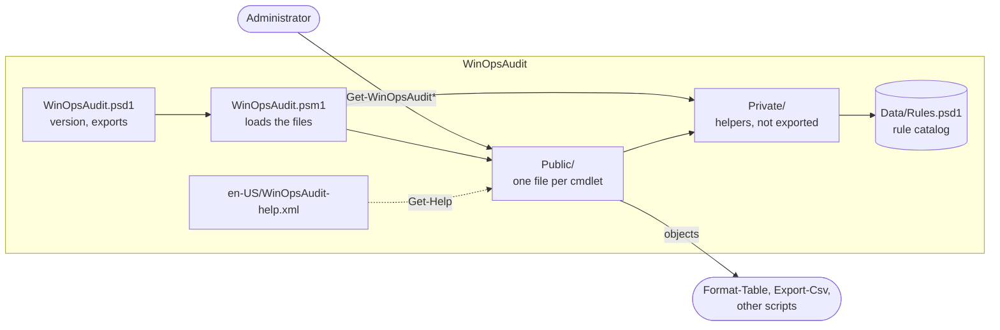
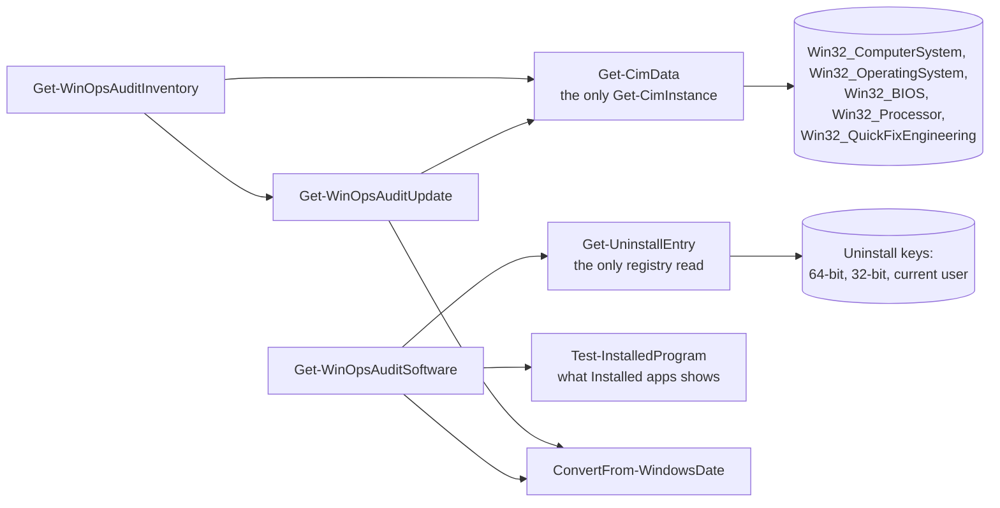
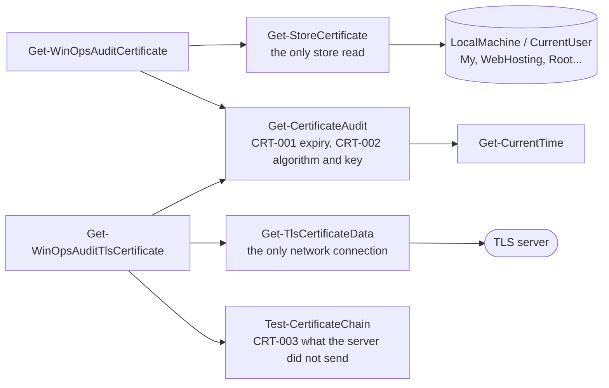
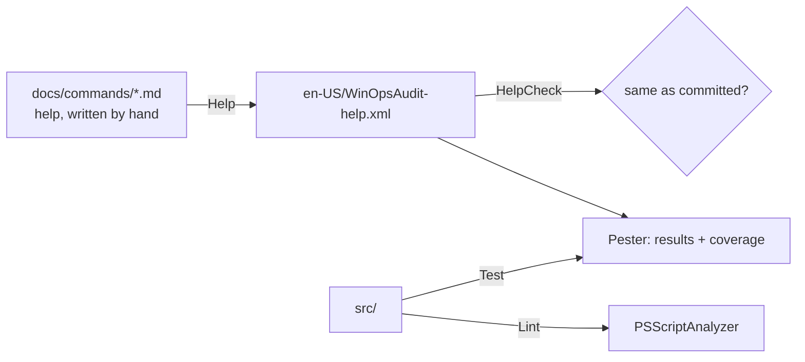

# Architecture

WinOpsAudit is a PowerShell 7 script module. This page shows how it is put together and how it is
built; it grows with the module.

## The module

- **Manifest (`WinOpsAudit.psd1`).** The module's card: its version, the PowerShell it needs (7.4 or
  later) and the cmdlets it exports. PowerShell reads it before loading anything.
- **Public and private.** `Public/` holds the cmdlets people use, one per file; `Private/` holds
  helpers that are not exported and can change freely.
- **Objects, not text.** Cmdlets return objects with a type name (`WinOpsAudit.Rule`,
  `WinOpsAudit.Inventory`...), never formatted text: the caller decides whether it becomes a
  table, a CSV or input for another script.
- **Read-only.** No cmdlet changes anything ([ADR 0001](adr/0001-read-only-module.md)).
- **Default views.** `WinOpsAudit.Format.ps1xml` says which columns the software, update and
  certificate objects show in a table. It changes how they look, not what they hold.

## The inventory

- **Two doors to Windows.** Everything that only exists on Windows goes through two private helpers:
  `Get-CimData` (CIM) and `Get-UninstallEntry` (registry). The tests replace those two with prepared
  data, so the rest of the logic (sums, filters, dates, errors) runs on Linux too. On Windows, more
  tests run the cmdlets against the real system.
- **Outside Windows** the cmdlets stop before reading anything, with the error id `WindowsOnly`.
- **Errors that stop and errors that do not.** If the computer or its system cannot be read, the
  inventory stops. If only the updates fail, the inventory is still returned, with an error and the
  update summary empty. If one uninstall key cannot be read, the other two are still listed.
- **Software from the registry**, never from `Win32_Product`
  ([ADR 0002](adr/0002-software-from-the-registry.md)). The registry view (64 or 32 bits) is chosen
  explicitly, so the result is the same from a 32-bit or a 64-bit PowerShell.

## The certificates

- **One check, two sources.** `Get-CertificateAudit` describes a certificate and applies CRT-001 and
  CRT-002, whether it comes from a store or from a server. Its clock is `Get-CurrentTime`, so the
  tests set the date instead of depending on the day they run.
- **The stores are opened read-only**, and only if they exist. Like the inventory, the store cmdlet
  only runs on Windows; the tests replace `Get-StoreCertificate` with certificates they make.
- **The TLS cmdlet runs anywhere.** It does the handshake and closes the connection, accepting any
  certificate: an expired one is what the audit wants to see. It is not mocked in the tests: they
  start real TLS servers on 127.0.0.1, with certificates made in the test, on Linux and Windows.
- **The chain is judged by what the server sends**
  ([ADR 0003](adr/0003-chain-judged-by-what-the-server-sends.md)): the chain this computer would
  build is compared with the certificates the server sent, and every intermediate that came from
  this computer is reported as missing.

## The build

`build.ps1` runs the same steps locally and in CI, on Linux and Windows. The tools it uses are
pinned in `build/requirements.psd1`.
