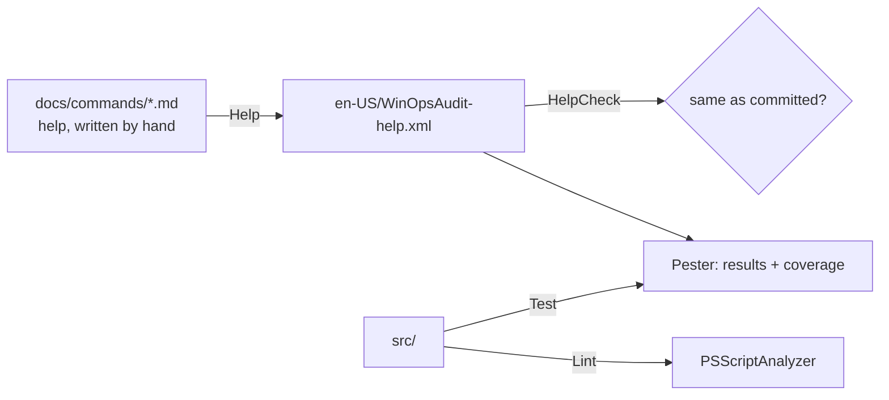

# Architecture

WinOpsAudit is a PowerShell 7 script module. This page shows how it is put together and how it is
built; it grows with the module.

## The module

- **Manifest (`WinOpsAudit.psd1`).** The module's card: its version, the PowerShell it needs (7.4 or
  later) and the cmdlets it exports. PowerShell reads it before loading anything.
- **Public and private.** `Public/` holds the cmdlets people use, one per file; `Private/` holds
  helpers that are not exported and can change freely.
- **Objects, not text.** Cmdlets return objects with a type name (`WinOpsAudit.Rule`), never
  formatted text: the caller decides whether it becomes a table, a CSV or input for another script.
- **Read-only.** No cmdlet changes anything ([ADR 0001](adr/0001-read-only-module.md)).

## The build

`build.ps1` runs the same steps locally and in CI, on Linux and Windows. The tools it uses are
pinned in `build/requirements.psd1`.
